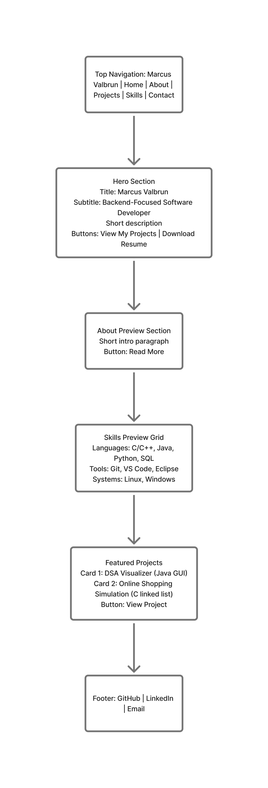

# UPDATE Fall 2026 Midsemester Project

**Marcus Valbrun · Personal Portfolio Website**

This edition revises my portfolio from the previous semester. The original planning document is preserved below as a historical record; this update describes the current website and supersedes the earlier career, design, and interaction descriptions.

## Project overview and target audience

My goal is now to ultimately become a **project manager**, while remaining open to **application development, backend management, and IT** roles. The site is intended for employers, internship recruiters, professors, and peers who want to understand both my technical foundation and my growing interest in coordination and leadership. I am pursuing a BS in Computer Science at Farmingdale State College, with graduation expected in **December 2026**, as listed in the supplied resume.

## Content strategy and information organization

The five pages remain Home, About, Projects, Skills, and Contact. The resume is a linked PDF rather than a separate page. Each page now has consistent navigation, a current-page indicator, a theme toggle, social links, and a footer.

- **Home:** a new introduction connecting development and project management, recent project highlights, career direction, and a contact invitation.
- **About:** revised career goals, education, IT support at Staples, student mentoring, and event coordination. Graduation information now follows the supplied resume; unsupported GPA claims were removed.
- **Projects:** PlayThis and lostnfound join the Java Data Structures & Algorithms Visualizer and C Online Shopping Simulation.
- **Skills:** programming and web technologies, tools and operating systems, practical IT support, and experience communicating and coordinating with people. Project management is an aspiration, not a claim of an established professional title.
- **Contact:** opportunities across the stated career interests, email and social links, plus an email-draft helper.
- **Resume:** replaced the downloadable file with the supplied ValbrunResume.pdf. Its contents are not rewritten; the website includes newer projects and career goals beyond that document.

**PlayThis** is a fun HTML/CSS/JavaScript playlist website using Apple’s music API and listener input. [Live website](https://visionarymarc.github.io/PlayThis) · [Source](https://github.com/visionarymarc/PlayThis).

**lostnfound** is my ongoing collaborative CSC 490 senior project for Fall 2026 at Farmingdale State College. It is a campus/community lost-and-found app using React, TypeScript, and Firebase, with item posts, profiles, and private chats. The team uses Agile/Scrum. The portfolio describes my team participation without inventing individual task ownership or claiming that planned marketplace features are complete. [Repository](https://github.com/visionarymarc/lost-n-found).

## Visual design

The new design uses oversized headings, italic serif emphasis, violet and lime project artwork, rounded panels, and an editorial layout. Dark mode pairs charcoal surfaces with soft violet accents; light mode pairs warm off-white surfaces with a darker violet accent for readable text. Body text uses system sans-serif fonts, labels use monospace, and highlighted words use Georgia. No external font download or UI framework is required.

The homepage flows from a large introduction and career note to a focus strip, recent projects, a short biography, and a contact invitation. Project artwork is drawn using CSS rather than third-party images. Responsive grids collapse into a single column on smaller screens, while navigation wraps onto its own row. Hover transforms, an animated asterisk, and playlist bars add movement without hiding content.

### Updated wireframe

```text
DESKTOP
┌───────────────────────────────────────────────────────┐
│ mv.       Home About Projects Skills Contact   Theme   │
├───────────────────────────────────────────────────────┤
│ Introduction / large headline     Career note          │
│ Short bio / Projects + Resume     Rotating asterisk    │
├───────────────────────────────────────────────────────┤
│ Project management / Application development / IT      │
├───────────────────────────┬───────────────────────────┤
│ PlayThis artwork + detail │ lostnfound artwork + detail│
├───────────────────────────┴───────────────────────────┤
│ About heading             Career direction             │
│ Contact invitation / button                            │
│ Footer / GitHub / LinkedIn / Email                      │
└───────────────────────────────────────────────────────┘
MOBILE: navigation wraps; hero, project cards, and about
content stack vertically; all content remains available.
```

The original `wireframe.png` below is retained as the previous semester’s planning artifact. The diagram above documents the updated layout.

## Interaction and accessibility

- **Light/dark mode:** starts with the system preference and remembers an explicit choice in localStorage across pages and visits. If storage is unavailable, toggling still works on the current page. The button’s accessible label describes its next action.
- **Back to top:** appears after scrolling and returns to the top. Reduced-motion users get immediate scrolling.
- **Contact helper:** labeled required fields validate name, email, and message. Submitting generates an encoded `mailto:` draft link; the visitor then opens that link in their email app. The website has no mail backend, stores no form data, and never claims a message was sent. The direct email link works without JavaScript; the helper button stays disabled when JavaScript is unavailable.
- **Motion:** CSS keyframes animate decorative elements; `prefers-reduced-motion` disables animations, transitions, and smooth scrolling. All text remains visible without JavaScript.
- **Keyboard access:** skip-to-content link, visible focus outlines, native buttons, semantic landmarks, linked form labels, and current-page navigation indicators.
- **Feedback:** hover/focus styling, updated theme button text, native form validation, and a polite status message for the email draft action.

## Technical overview and milestones

1. Reviewed the prior site, assignment reference, supplied resume, and current project repositories.
2. Updated career positioning, education, projects, and resume download.
3. Rebuilt the shared responsive CSS and consistent five-page layout.
4. Added early theme initialization in `js/theme.js` and theme, scrolling, and email-draft behavior in `js/script.js`.
5. Validated pages, local resources, desktop/mobile layout, theme persistence, reduced motion, and contact behavior in Chromium; all checks passed.

This remains a static HTML/CSS/JavaScript website suitable for GitHub Pages, with no install or build step. For local development, run `python3 -m http.server 8000` from the repository root. Publishing requires committing/pushing the changes to the branch configured for GitHub Pages; editing the checkout alone does not update the live site.

## Validation results

Chromium checks passed on all five pages at 1440, 768, 390, and 320 pixels wide, with no horizontal overflow. All referenced local resources returned HTTP 200 and the resume contained a valid PDF header. Theme switching persisted across navigation and reload. Reduced-motion settings disabled decorative animation, and the back-to-top control returned to the top. Contact checks covered required-field validation, encoded draft contents, and truthful status feedback. The no-JavaScript fallback kept content readable and the email helper disabled. No browser JavaScript errors were observed. Desktop and mobile homepage screenshots were visually reviewed.

These checks validate the local site, not a deployment or actual email delivery. PlayThis’s source was reviewed through Git access; its hosted page returned an access error from the setup environment, so external service availability was not validated.

## Resources and references for this update

- Supplied Portfolio Website Project assignment: used as reference for documentation, content, design, and accessibility criteria; not treated as a request to submit or publish anything.
- Supplied ValbrunResume.pdf: education, experience, skills, and downloadable resume.
- [PlayThis source](https://github.com/visionarymarc/PlayThis) and [lostnfound source](https://github.com/visionarymarc/lost-n-found): project descriptions.
- [MDN: CSS custom properties](https://developer.mozilla.org/en-US/docs/Web/CSS/Using_CSS_custom_properties)
- [MDN: prefers-reduced-motion](https://developer.mozilla.org/en-US/docs/Web/CSS/@media/prefers-reduced-motion)
- [MDN: localStorage](https://developer.mozilla.org/en-US/docs/Web/API/Window/localStorage)
- [GitHub Pages documentation](https://docs.github.com/en/pages)

---

# Previous semester: original design document

The answers below describe the original submission and are preserved for comparison. See the Fall 2026 update above for current decisions.

# Personal Portfolio Website

**Marcus Valbrun**  
BCS 350 – Web Database Development 
Mid Semester Project 

---

# Project Overview

This project is a personal portfolio website designed to showcase my background, technical skills, and programming projects as a Computer Science student.

---

# Target Audience

- Software engineering recruiters
- Internship hiring managers
- Technology companies
- Professors and peers

---

# PART 1: CONTENT

### 1. What is your full name?

**Marcus Valbrun**

### 2. What is the purpose of your portfolio website?

The purpose of this portfolio website is to professionally present my background, technical skills, and software development projects to potential employers and internship recruiters.

### 3. Who is the target audience?

- Software engineering recruiters
- Internship hiring managers
- Technology companies
- Professors and peers

### 4. What skills do you want to highlight?

I want to highlight my strengths in backend-oriented programming, including Java, C/C++, Python, SQL, and Data Structures & Algorithms. I am particularly comfortable working with structured logic, data management, and system-level concepts. I also have experience using Git for version control and working in Linux environments.

### 5. What projects or work will you showcase?

I will showcase my **Data Structures & Algorithms Visualizer** developed in Java, which demonstrates algorithm runtime comparisons and data structure implementation.

I will also include my **Online Shopping Simulation** written in C, which utilizes linked lists for inventory management and simulates an interactive shopping experience.

These projects demonstrate my ability to design logical systems and manage structured data.

### 6. How will you describe yourself in a short professional bio?

I am a Computer Science student at Farmingdale State College with a strong interest in backend development and systems design. My academic experience has focused heavily on data structures, algorithms, and structured programming in languages such as Java, C, and Python.

I enjoy solving complex logical problems and building efficient systems that manage and process data effectively. While backend development is my primary interest, I remain open to expanding my skills into full-stack development and continuing to improve as a software engineer.

---

### 7. What pages will your site include (Home, About, Projects, Contact, etc.)?

The website will include the following pages:

- Home  
- About  
- Projects  
- Skills  
- Resume  
- Contact  

Each page focuses on a specific aspect of my professional profile while maintaining consistent navigation and design.

---

### 8. What is your career goal or desired role?

My primary career goal is to work as a **backend developer or software engineer**, focusing on data management, system architecture, and application logic.

However, I remain open to full-stack opportunities that allow me to grow and expand my skill set.

### 9. What technologies or tools do you have experience with?

**Languages**

- C / C++
- Java
- Python
- SQL

**Tools**

- Git
- Visual Studio Code
- Eclipse
- Microsoft 365

**Systems**

- Windows
- Linux

---

### 10. What achievements or experiences are worth highlighting?

One experience worth highlighting is my role as a **Tech Associate**, where I gained hands-on experience troubleshooting technology and assisting customers with technical issues.

This role strengthened my problem-solving skills and provided exposure to real-world technical environments.

---

### 11. What call-to-action should visitors take (contact you, view projects, download resume)?

Primary call-to-action:

**View My Projects**

Secondary call-to-action:

**Download Resume**

These actions encourage visitors to explore my work and easily access my resume.

---

### 12. Will you include a resume? In what format?

Yes.

The website includes a **downloadable PDF version of my resume**, accessible from both the homepage and navigation bar.

---

### 13. What social or professional links will you include (GitHub, LinkedIn, etc.)?

The website includes links to my professional profiles:

- GitHub
- LinkedIn
- Email

These links allow visitors and potential employers to connect with me and explore my work further.

---

# PART 2: DESIGN

### 1. What overall style will best represent you (minimalist, creative, professional, etc.)?

The overall style of the website is minimalist and professional. The goal was to create a clean layout that focuses on readability and clear presentation of information rather than complex visual elements. This approach reflects a developer-focused portfolio where the content and projects are the main focus.

---

### 2. What color scheme will you use and why?

The website uses a dark color scheme with light text and a teal accent color. The dark theme provides strong contrast for readability while creating a modern developer-oriented appearance. The accent color is used for buttons and interactive elements to guide the user’s attention.

---

### 3. What fonts will you use for headings and body text?

Headings use a monospace-style font to reflect a technical and developer-focused aesthetic. Body text uses simple system sans-serif fonts to maintain readability and ensure compatibility across different devices and operating systems.

---

### 4. How will your design reflect your personality or field?

The design reflects my interest in backend development and software engineering by emphasizing structure, simplicity, and functionality. Instead of focusing heavily on visual effects, the site prioritizes clear organization and efficient presentation of information.

---

### 5. What layout will your homepage follow?

The homepage follows a vertical scrolling layout consisting of several sections:

- Navigation bar
- Introduction or hero section
- About preview
- Skills overview
- Featured projects
- Footer

This structure allows visitors to quickly understand who I am and explore the rest of the site.

---

### 6. How will you organize project sections visually?

Projects are organized using card-style sections that include the project title, description, and technologies used. This layout separates each project clearly and allows visitors to quickly scan the page.

---

### 7. Will the site be mobile-friendly? How will you ensure responsiveness?

Yes, the site is designed to be mobile-friendly. Responsive design is achieved through flexible layouts, responsive containers, and CSS adjustments that allow the layout to adapt to different screen sizes.

---

### 8. What visual hierarchy will guide visitors?

Visual hierarchy is created through larger section headings, smaller descriptive text, and accent-colored buttons for important actions. This helps guide visitors through the page in a logical order.

---

### 9. How will consistency be maintained across pages?

Consistency is maintained by using the same navigation bar, color scheme, typography, and layout structure across all pages. Shared CSS styles ensure that each page follows the same design rules.

---

### 10. How will accessibility be considered (contrast, font size, readability)?

Accessibility is considered through high color contrast between text and background, readable font sizes, and clear spacing between elements. These choices help ensure that the site is easy to read and navigate for a wide range of users.

---

### 11. Will you use icons, images, or illustrations? Why?

The design uses minimal visual elements. The focus of the site is on text and structured content, allowing visitors to focus on the information and projects rather than decorative graphics.

---

### 12. What portfolio websites inspired your design?

The design was inspired by simple developer portfolios that focus on minimal layouts, clear project presentation, and dark-themed interfaces commonly used by software engineers.

---

# PART 3: INTERACTIVITY

### 1. What interactive elements will your site include (navigation menus, buttons, forms)?

The site includes several interactive elements including navigation links, buttons for navigation and downloading the resume, and a “Go to Top” button that allows users to quickly return to the top of the page.

---

### 2. Will your site include a contact form? How will it work?

Yes. The site includes a contact form where visitors can enter their name, email address, and message. This allows visitors to easily reach out with questions or opportunities.

---

### 3. What JavaScript features will you implement?

The site includes a JavaScript feature that allows users to click a “Go to Top” button which smoothly scrolls the page back to the top.

---

### 4. How will users receive feedback from interactions?

Users receive feedback through visual responses such as button hover effects and the scrolling behavior triggered when clicking the “Go to Top” button.

---

### 5. How does interactivity improve the user experience?

Interactivity improves the user experience by making navigation easier and more intuitive. Features such as buttons and navigation links help visitors move through the site efficiently.

---

# Visual Design (Wireframe)

A wireframe was created during the planning stage to outline the layout and structure of the website before development began. The wireframe helped determine the placement of major sections such as the navigation bar, introduction section, skills overview, projects section, and footer.

The wireframe served as a visual guide to ensure the layout remained organized and consistent throughout development.


Example:


---

# Technical Overview

The website was built using the core web technologies learned in class.

Technologies used:

- HTML5 – used to structure the content of the website
- CSS3 – used for styling, layout, and responsive design
- JavaScript – used to add interactive functionality such as the “Go to Top” button
- GitHub – used for version control and project hosting
- GitHub Pages – used to deploy and host the live website

The goal of the technical implementation was to keep the code simple, readable, and easy to expand in the future.

---

# Timeline / Project Milestones

### Planning Phase
- Answered design document questions
- Created initial content structure
- Designed wireframe layout

### Development Phase
- Built HTML page structure
- Implemented CSS styling
- Organized website navigation

### Finalization Phase
- Added JavaScript functionality
- Tested navigation and responsiveness
- Uploaded project to GitHub
- Deployed website using GitHub Pages

---

# Visual Design (Wireframe)

A wireframe was created during the planning stage to outline the layout and structure of the website before development began. The wireframe helped determine the placement of major sections such as the navigation bar, introduction section, skills overview, projects section, and footer.

The wireframe served as a visual guide to ensure the layout remained organized and consistent throughout development.

Example of homepage Skeleton:



---


# External Resources

The following resources were used during the development of this project:

- MDN Web Docs – https://developer.mozilla.org  
- W3Schools – https://www.w3schools.com  
- GitHub Pages Documentation – https://docs.github.com/en/pages  

These resources were used to review HTML, CSS, and JavaScript syntax and best practices.

---

# Live Website

[GitHub Pages Link](https://visionarymarc.github.io/portfolio-website/)

---

# GitHub Repository
[Repository Link](https://github.com/visionarymarc/portfolio-website)
